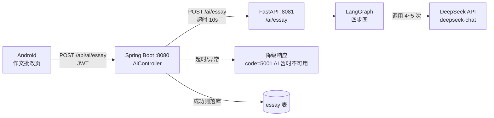
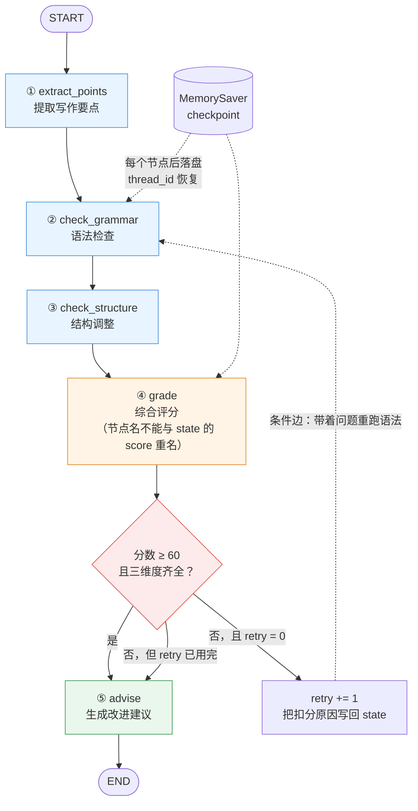
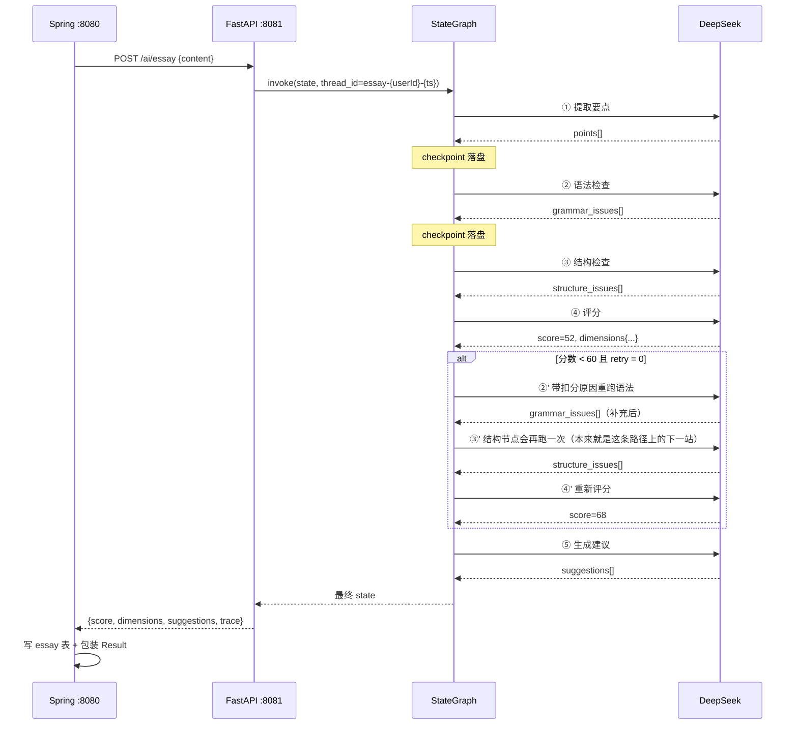
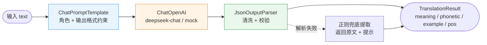

# AI 服务节点图 · LangGraph 与 LangChain

> 论文里讲「用了 LangGraph」是一句话，答辩时会被追问的是**图长什么样、为什么这么连、挂了怎么办**。
> 本文把两个能力的图、状态、分支条件全画出来，代码实现见 `python-ai/app/graph.py` 与 `chain.py`。

---

## 一、整体调用链

先看请求怎么走到图里。App 永远只连 8080，Python 的 8081 是内部服务。



一次作文批改会发生 **4~5 次模型调用**（四个节点各一次，触发重试时多一次），总耗时通常 6~12 秒——所以 Spring 侧的超时必须 ≥10 秒，且必须降级。

---

## 二、LangGraph 作文批改四步图

### 2.1 图结构

实线是固定边，虚线是条件边。**`score` 节点出来的那条条件边是整张图存在的理由**——它让「评分不达线」这种情况能回到语法节点重跑，而不用从头再来。



**读图要点（答辩可以直接说）：**

1. **四个节点串行**：要点 → 语法 → 结构 → 评分，前一步的输出是后一步的输入，天然是 DAG，不是一次 prompt 能替代的。
2. **评分后置**：评分必须看到前三步的结果，所以它只能放在最后一个固定节点。
3. **唯一的条件边**：`score` → 「分数够不够」→ 够就走 `advise` 收尾，不够就回 `check_grammar`。
4. **重试有上限**：`retry` 存在 state 里，最多回退 1 次。没有上限的环 = 死循环 + 烧钱。
5. **checkpoint 的意义**：每个节点跑完都把 state 落盘，用 `thread_id` 就能中断后从断点继续，不用重跑已经成功的节点。

### 2.2 状态定义（State）

图里流动的唯一数据结构。**只放数据，不放连接、不放锁**。

```python
class EssayState(TypedDict, total=False):
    content: str                  # 输入：学生作文原文
    points: list[str]             # ① 写作要点
    grammar_issues: list[str]     # ② 语法问题列表
    structure_issues: list[str]   # ③ 结构问题列表
    dimensions: dict              # ④ {grammar, structure, vocabulary} 各 0-100
    score: int                    # ④ 总分 0-100
    suggestions: list[str]        # ⑤ 改进建议
    retry: int                    # 条件边用的重试计数
    trace: list[str]              # 执行轨迹，用于日志与测试断言
```

`total=False` 很关键：节点只返回自己新增的字段，LangGraph 会做增量合并，不要每个节点都返回完整 state。

### 2.3 每个节点干什么、挂了怎么办

| 节点 | 输入 | 输出 | 失败处理 |
|---|---|---|---|
| `extract_points` | `content` | `points`（3~5 条） | 返回空列表也算成功，后续节点降级处理 |
| `check_grammar` | `content` + `points` | `grammar_issues` | 模型超时 → 该节点重试 1 次，仍失败则记空列表并继续 |
| `check_structure` | `content` + `grammar_issues` | `structure_issues` | 同上 |
| `grade` | 前三步全部结果 | `score` + `dimensions` | 缺维度视为不完整，触发条件边。**节点名不能叫 `score`**——LangGraph 不允许节点名与 state 键同名 |
| `advise` | `score` + 所有 issues | `suggestions`（3 条） | 失败时返回兜底文案「请重试」 |

**降级原则**：单个节点失败**不让整张图崩**。图的价值在于部分失败可以局部重跑，直接抛 500 就把这个价值扔了。

### 2.4 条件边的判定函数

```python
def route_after_score(state: EssayState) -> str:
    complete = len(state.get("dimensions", {})) == 3
    if state.get("score", 0) >= 60 and complete:
        return "advise"
    if state.get("retry", 0) < 1:
        return "retry"
    return "advise"          # 重试用尽，带着现有结果收尾
```

三个返回值对应图上的三条出边，**这是 LangGraph 与普通 Chain 的分水岭**：Chain 只能一路向前，图能根据中间结果选下一步。

### 2.5 一次执行的时序



---

## 三、LangChain 翻译链

翻译是**一次模型调用**就能完成的事，所以用 Chain，不上图。这个对比本身就是答辩要讲的内容。



**为什么这里不上图**：图的价值来自「多步 + 分支 + 可中断」，翻译一步到底、没有分支，套图只会多一层调度开销和一组没用上的 state 字段。**能一次做完的事不该上图**——这句话最好背下来，是这个项目里最能体现工程判断的一句。

---

## 四、两种编排方式对照

| 维度 | LangGraph 四步图 | LangChain 翻译链 |
|---|---|---|
| 模型调用次数 | 4~5 次 | 1 次 |
| 有无分支 | 有，评分后条件边 | 无 |
| 中间结果 | 每步存 state，可 checkpoint | 只在内存里过一遍 |
| 失败重跑粒度 | 单节点重跑 | 整体重跑 |
| 耗时 | 6~12 秒 | 1~3 秒 |
| 适用判断 | 多步骤、每步可独立验证 | 单次转换 |

---

## 五、Mock 模式（没有 Key 时图照样能跑）

这一节是给「答辩前一晚断网」准备的。`llm.py` 里做一层工厂：

```python
def build_llm():
    key = os.getenv("DEEPSEEK_API_KEY", "").strip()
    if key:
        return ChatOpenAI(model="deepseek-chat", base_url="https://api.deepseek.com/v1",
                          api_key=key, timeout=10, max_retries=0, temperature=0.2)
    return MockChatModel()      # 按 prompt 关键词返回结构合法的假 JSON
```

`MockChatModel` 按 prompt 里出现的关键词返回不同内容：含「要点」返回 points、含「语法」返回 issues、含「评分」返回 score 和 dimensions。**图的拓扑、条件边、checkpoint 全都是真跑**，只有模型这一层是假的——这样离线也能证明图的逻辑是对的，测试也可以完全不依赖网络。

---

## 六、日志与可观测性

答辩现场最想给别人看的不是界面，是**日志里那串节点名**。每个节点进来时打一行：

```
[graph] thread=essay-1-20261115 node=extract_points retry=0
[graph] thread=essay-1-20261115 node=check_grammar retry=0
[graph] thread=essay-1-20261115 node=check_structure retry=0
[graph] thread=essay-1-20261115 node=grade retry=0 score=52 complete=False
[graph] thread=essay-1-20261115 route=retry
[graph] thread=essay-1-20261115 node=check_grammar retry=1
[graph] thread=essay-1-20261115 node=check_structure retry=1
[graph] thread=essay-1-20261115 node=grade retry=1 score=68 complete=True
[graph] thread=essay-1-20261115 route=advise
[graph] thread=essay-1-20261115 node=advise retry=1
[graph] done in 8.4s, 5 llm calls
```

这一段日志同时证明了四件事：图在跑、节点按序、条件边生效、重试有上限。**录屏时一定要把这一屏录进去。**
