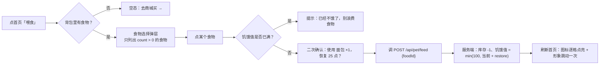
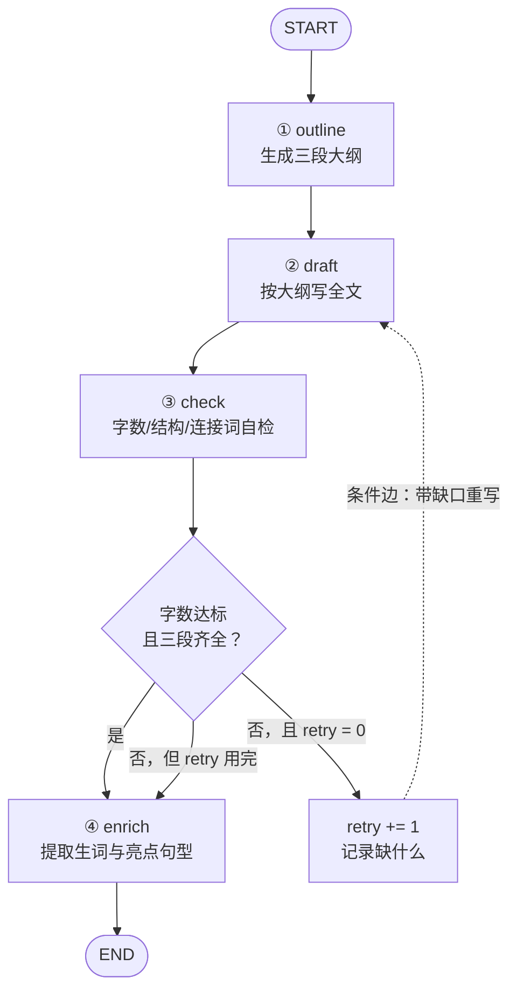
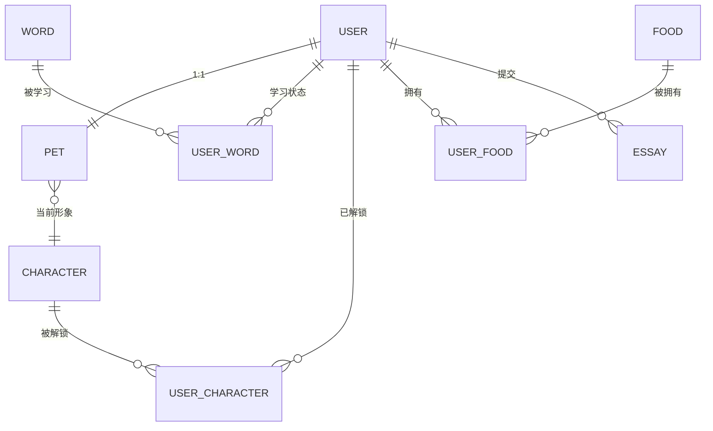
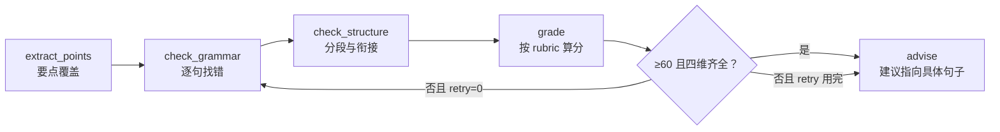

# 英语学习 App · 整改方案

> 版本：v1.0　日期：2026-11-18
> 依据：指导老师整改意见（原文见附录 A）
> 现状基线：7 张表 / 13 个接口 / 4 个页面，宠物单形象 + 金币解锁，背单词仅"认识 / 不认识"
> 整改目标：**把"背单词 + 养宠物"的小闭环，升级成"学习 → 金币 → 食物/形象 → 养成"的完整养成系统**，并补齐展示层与规则层

---

## 实施进度（2026-11-18）

| 期 | 内容 | 状态 | 验证 |
|---|---|---|---|
| P0 | `food` / `user_food` 两表、买食物、按食物喂食、`/api/foods`·`/api/bag`·`PUT /api/user/nickname` | ✅ 完成 | 冒烟 32/32 |
| P1 | 新首页（气泡 + 形象 + 名字 + 等级 + 10 格饥饿 + 经验条 + 5 入口）、商城、背包、设置、学习中心 | ✅ 完成 | 模拟器 10 项截图 |
| P2 | 背单词三题型（认识 / 缺空 / 完整）+ 答题消耗饥饿 | ✅ 完成 | 冒烟 25/25，模拟器 4 屏 |
| P3 | 作文 rubric（四维 30/25/25/20）+ 扣分明细、作文生成图（第二张 LangGraph） | ✅ 完成 | 真实模型：86 分/2 条扣分；生成 172 词 |
| P4 | 设计令牌、手写字体、容器色统一、首页留白重排 | ✅ 基本完成 | 截图 28-35 |

> 已实现部分的细节与截图见 `doc/测试报告.md` 第十一节。

---

## 目录

1. [整改意见与现状差距](#一整改意见与现状差距)
2. [整改后的产品结构](#二整改后的产品结构)
3. [首页与宠物展示](#三首页与宠物展示)
4. [饥饿值与食物体系](#四饥饿值与食物体系)
5. [商城与背包](#五商城与背包)
6. [设置](#六设置)
7. [学习中心与背单词规则](#七学习中心与背单词规则)
8. [作文打分规则](#八作文打分规则)
9. [作文生成规则](#九作文生成规则)
10. [界面美化规范](#十界面美化规范)
11. [数据模型变更](#十一数据模型变更)
12. [接口变更](#十二接口变更)
13. [AI 服务变更与节点图](#十三ai-服务变更与节点图)
14. [开发排期](#十四开发排期)
15. [验收清单](#十五验收清单)
16. [风险与取舍](#十六风险与取舍)
17. [附录](#附录)

---

## 一、整改意见与现状差距

老师提了 9 条意见，本质是三类问题：**展示不全**（饥饿/经验/等级/名字）、**功能不成体系**（缺商城/背包/设置/学习入口）、**规则太浅**（喂食太简单、背单词只有认识不认识、作文只有打分没有规则）。

| # | 整改意见 | 现状 | 差距 | 整改动作 |
|---|---|---|---|---|
| 1 | 形象：卡通人物 | 6 个程序绘制的像素占位图 | 占位图不够"卡通" | 重做卡通形象素材，规范尺寸与命名，逻辑不变 |
| 2 | 饥饿值用《我的世界》图标展示 | 一根 `LinearProgressIndicator` 进度条 | 无"格"的概念，看不出剩几格 | 改为 10 个鸡腿图标，支持满/半/空三态 |
| 3 | 经验值展示 | 只有文本 `exp` 数字 | 无进度感 | 加经验条 + `当前/下一级` 数值 |
| 4 | 等级展示 | 文本 `Lv.1` 混在名字里 | 不醒目 | 独立等级徽章 + 升级阈值规则 |
| 5 | 形象名称展示 | 首页只显示宠物名 `Luna` | 形象名只在选择面板里 | 首页同时展示形象名与宠物名 |
| 6a | 喂食要能选食物，每种恢复不同 | 固定扣 5 金币，饿值直接置 100 | 没有"食物"这个概念 | 新增食物字典 + 背包 + 按食物恢复 |
| 6b | 商城（形象 + 食物） | 只有形象解锁（藏在 BottomSheet） | 无独立商城，无食物商品 | 新建商城页，两个 Tab |
| 6c | 背包 | 无 | 完全没有 | 新建背包页，食物可按数量使用 |
| 6d | 设置 | "我的"页只能退出登录 | 无设置项 | 新建设置页（资料/昵称/音效/退出/关于） |
| 6e | 学习入口（背单词/翻译/作文打分/作文生成） | 首页直接跳背单词，AI 藏在"我的"弹窗 | 无学习中心；缺作文生成 | 新建学习中心页，4 个能力卡片 |
| 7 | 制定饥饿值扣除规则 | 隐含在代码里（每 20 分钟 -1），无文档、无状态分级 | 规则不可见 | 明确规则表 + 状态分级 + 饥饿为 0 的后果 |
| 8 | 背单词要完整默写 + 缺空默写 | 只有"认识/不认识"自评 | 无法验证拼写 | 三题型（认识 / 缺空 / 完整）+ 判定与评分 |
| 9 | 作文打分要有规则 | 模型自由评分，维度名固定但标准不明 | 分数无法解释 | 制定 100 分 rubric，写进 prompt 与返回结构 |
| 10 | 作文生成要写作规则 | 无此功能 | 缺失 | 新增生成图，含结构/字数/难度约束 |
| 11 | 文本框与框架要美观 | 默认 Material 组件，间距随意 | 视觉不统一 | 统一设计令牌 + 组件规范 + 状态页 |

**整改后规模预估**：表 7 → 9，接口 13 → 19，页面 4 → 8，AI 能力 2 → 3（多一张 LangGraph 图）。

---

## 二、整改后的产品结构

### 2.1 信息架构

```mermaid
flowchart TD
    L["登录 / 注册"] --> H["首页（宠物舞台）"]

    H --> F["喂食"]
    H --> S["商城"]
    H --> B["背包"]
    H --> M["设置"]
    H --> ST["学习中心"]

    F --> F1["食物列表（背包内）"]
    F1 --> F2["选择 → 确认 → 恢复饥饿值"]

    S --> S1["形象 Tab"]
    S --> S2["食物 Tab"]
    S2 --> S3["购买 → 进入背包"]

    B --> B1["食物（可用）"]
    B --> B2["形象（可切换）"]

    ST --> W["背单词"]
    ST --> T["单词翻译"]
    ST --> E1["作文打分"]
    ST --> E2["作文生成"]

    W --> W1["认识 / 不认识"]
    W --> W2["缺空默写"]
    W --> W3["完整默写"]
```



### 2.2 页面清单（4 → 8）

| # | 页面 | 类型 | 主要职责 |
|---|---|---|---|
| 1 | 登录 / 注册 | Activity | 不变，只做视觉统一 |
| 2 | 首页 | Activity | 宠物舞台 + 五要素展示 + 5 个功能入口 |
| 3 | 学习中心 | Activity | 4 个能力卡片（新增） |
| 4 | 背单词 | Activity | 三题型改造（重构） |
| 5 | 商城 | Activity | 形象 / 食物两个 Tab（新增） |
| 6 | 背包 | Activity | 食物 + 形象（新增） |
| 7 | 设置 | Activity | 资料 / 昵称 / 音效 / 退出 / 关于（新增） |
| 8 | 形象选择面板 | BottomSheet | 保留，从商城与背包都能唤起 |

> 原"我的"页取消：统计信息移到首页顶部（点击展开），账号相关并入设置页。**页面数增加到 8，但导航只有 5 个入口**，不会再乱。

### 2.3 首页功能入口

首页底部固定 5 个按钮，**横向等宽、图标在上文字在下**，顺序固定为：

```
[ 喂食 ]  [ 学习 ]  [ 商城 ]  [ 背包 ]  [ 设置 ]
```

- 喂食、学习是**主操作**，用实心按钮（主色填充）
- 商城、背包、设置是**次级操作**，用描边按钮
- 学习按钮上叠加一个小红点：当"今日单词未完成"时显示，完成即消失

---

## 三、首页与宠物展示

### 3.1 布局分区

```
┌─────────────────────────────────────┐
│  你好，演示          🪙 金币 53      │  ← 顶部栏（昵称 + 金币胶囊）
├─────────────────────────────────────┤
│                                     │
│            [ 卡通形象 ]              │  ← 宠物舞台（占屏幕 45%，居中）
│                                     │
│         熊猫 · 名叫 Luna             │  ← 形象名 + 宠物名
│              🏅 Lv.3                │  ← 等级徽章
│                                     │
│  🍗🍗🍗🍗🍗◐○○○○  55 / 100         │  ← 饥饿值（10 格，支持半格）
│  ▓▓▓▓▓▓▓░░░░░░░  120 / 150 EXP      │  ← 经验条
│                                     │
├─────────────────────────────────────┤
│  [喂食] [学习] [商城] [背包] [设置]   │  ← 5 个功能入口
└─────────────────────────────────────┘
```

### 3.2 五要素展示规范

| 要素 | 展示形式 | 数据来源 | 缺省处理 |
|---|---|---|---|
| 形象 | `ImageView` 200×200dp，`fitCenter` | `pet.characterImage` → drawable 名 | 找不到资源用 `char_placeholder` |
| 形象名 | 16sp 加粗，主文字色 | `character.name`（如"熊猫"） | 空则不显示该行 |
| 宠物名 | 14sp 常规，次要文字色，格式"名叫 XX" | `pet.name` | 默认 `Luna` |
| 等级 | 胶囊徽章：主色底 + 白字 `Lv.N` | `pet.level` | 最低 1 |
| 饥饿值 | 10 个鸡腿图标 + "55 / 100" 文字 | `pet.hunger`（0–100） | 0 时整行变红并提示 |
| 经验 | 细进度条 + "120 / 150 EXP" | `pet.exp`、`pet.level` | 满级显示 `MAX` |

### 3.3 饥饿值图标（《我的世界》风格）

**图标数量与映射**：固定 10 格，每格代表 10 点。

| 剩余饥饿值 | 满格 | 半格 | 空格 |
|---|---|---|---|
| 100 | 10 | 0 | 0 |
| 95 | 9 | 1 | 0 |
| 55 | 5 | 1 | 4 |
| 4 | 0 | 1 | 9 |
| 0 | 0 | 0 | 10 |

**计算公式**（客户端只做展示换算，不做业务）：

```
满格 = hunger / 10 的整数部分
半格 = (hunger % 10) >= 5 ? 1 : 0
空格 = 10 - 满格 - 半格
```

**素材规范**：三张 64×64 PNG，统一像素风，命名 `ic_hunger_full.png` / `ic_hunger_half.png` / `ic_hunger_empty.png`，放在 `drawable-nodpi`。用 10 个 `ImageView` 排列（`LinearLayout` + 等分权重），按上面三个数字依次 `setImageResource`，**不要用自定义 View 绘制**——图标换图时改资源即可。

### 3.4 等级与经验

| 规则 | 定义 |
|---|---|
| 每级所需经验 | 固定 50 点（简化，不递增） |
| 当前等级 | `level = exp / 50 + 1` |
| 升级进度 | `exp % 50 / 50` |
| 满级 | 暂不设上限；经验条只显示当前级内进度 |
| 经验来源 | 认识 +2 / 缺空默写 +3 / 完整默写 +5 / 作文提交 +10 |

**升级反馈**：等级数字变化时，徽章做一次 300ms 缩放动画（1.0 → 1.2 → 1.0）+ 一行 Toast「Luna 升到 Lv.3 了」。这是全 App 唯一保留的两处动画之一。

---

## 四、饥饿值与食物体系

### 4.1 数值口径

| 项 | 值 | 说明 |
|---|---|---|
| 满值 | 100 | 10 格 × 10 点 |
| 自然消耗 | **1 点 / 20 分钟** | 等价 3 点/小时、72 点/天，满值约 33 小时耗尽 |
| 计算方式 | **读时现算**，不写定时任务 | `hunger = max(0, 100 - 分钟数 / 20)` |
| 学习影响 | **不额外消耗，也不恢复** | 取消旧版"答对 +2 饥饿值"的设定 |
| 恢复方式 | 只能靠喂食 | 食物见 4.3 |

> **为什么改掉"答对 +2 饥饿"**：旧规则里学习和饱食度正相关，等于"越学习越饱"，逻辑上说不通，也和食物系统冲突。新版让**学习产金币、金币买食物、食物养宠物**形成三段式，每个环节职责单一，答辩时一句话能讲清。

### 4.2 饥饿值状态分级

| 区间 | 状态 | 首页表现 | 行为限制 |
|---|---|---|---|
| 70–100 | 精神饱满 | 图标正常色，形象做轻微呼吸动画 | 无 |
| 40–69 | 有点饿 | 图标正常色，名字旁显示"有点饿了" | 无 |
| 20–39 | 饿了 | 图标变暗黄，顶部提示条常驻"该喂食了" | 无 |
| 1–19 | 很饿 | 图标变红，形象显示"委屈"表情（用第二种形象图，可选） | 可学习，但每轮开始弹一次提示 |
| 0 | 饿坏了 | 整行红色 + 抖动一次 | **禁止开始新的学习**，点学习弹「先喂饱我再去学习吧」并跳转喂食 |

### 4.3 食物清单（Minecraft 风格命名）

| 食物 | 图标命名 | 恢复饥饿 | 售价（金币） | 单位成本 | 说明 |
|---|---|---|---|---|---|
| 胡萝卜 | `food_carrot` | +10 | 5 | 0.50 币/点 | 应急小食 |
| 面包 | `food_bread` | +25 | 12 | 0.48 币/点 | 主力口粮 |
| 熟牛肉 | `food_beef` | +50 | 25 | 0.50 币/点 | 一天两顿 |
| 金苹果 | `food_golden_apple` | +100 | 55 | 0.55 币/点 | 一键喂满，略贵 |

**设计原则**：单位成本基本持平（0.48–0.55），**贵在"省事"而不是"更划算"**，避免玩家只买一种。金苹果稍贵，作为"懒人税"。

### 4.4 喂食流程



**关键规则**：

1. **喂食消耗的是库存，不是金币**——金币在商城阶段已经花掉了。这样"买"和"用"分开，背包才有意义。
2. **饥饿值满时禁止喂食**，避免浪费（也省掉"溢出怎么算"的麻烦）。
3. **一次只能喂一个**，不做"全部使用"。
4. 恢复值超出 100 的部分**直接截断**（理论上不会发生，因为满值禁止喂；但服务端仍要 `min(100, ...)` 兜底）。
5. 喂食成功后 `lastFedAt = now`，但要注意：**不能简单置 now**，否则会把"当前饥饿值 + restore"算错。正确做法是先算出目标值，再用反推公式写回 `last_fed_at`（沿用现有 `lastFedAtForHunger` 工具方法）。

### 4.5 金币收支平衡测算

| 项目 | 数值 |
|---|---|
| 每天自然消耗 | 72 点（24 小时 × 3 点/小时） |
| 每天喂食成本 | 约 34–36 币（按面包 0.48 币/点计） |
| 学习 10 词三关全对 | 40 币（认识 10×1 + 缺空 10×1 + 完整 10×2） |
| 每天净结余 | **约 +5 币**（刚够，攒不下多少） |
| 形象价格 | 50 / 100 / 200（鸭子 / 青蛙·企鹅 / 小熊·僵尸） |
| 攒一个 100 币形象 | 约 20 天 |

**结论**：日常喂食刚好打平，攒形象是长期目标。**如果老师觉得攒得太慢，把形象价格降到 30/60/120 即可**，只改 `character` 表的 `price` 字段，不动代码。

---

## 五、商城与背包

### 5.1 商城页

顶部两个 Tab（Material `TabLayout`）：**形象 / 食物**。

| Tab | 列表项 | 操作 | 状态文案 |
|---|---|---|---|
| 形象 | 形象图 + 名字 + 价格 | 点未解锁 → 二次确认扣币解锁；点已解锁 → 切换使用 | 「使用中」/「已解锁」/「50 金币」 |
| 食物 | 食物图 + 名字 + 恢复值 + 价格 + 数量选择器 | 点购买 → 扣币，库存 +N | 底部显示「拥有 N 个」 |

**数量选择器**：1 / 5 / 10 三个 `Chip`，默认 1。总价实时显示在购买按钮上：「购买 × 5（60 金币）」。

**食物购买规则**：
- 金币不足 → 按钮置灰 + 文案「金币不足，还差 12」
- 购买成功后 Toast「购买成功，背包 +5 面包」
- 失败（并发/余额变化）→ 服务端返回 `4001`，前台刷新余额

### 5.2 背包页

两个分组，用可折叠标题：

| 分组 | 内容 | 交互 |
|---|---|---|
| 食物 | 有库存的食物（图标 + 名字 + `×N` + 恢复值） | 点击 → 直接喂食（同 4.4 流程的确认弹层） |
| 形象 | 已解锁的形象（缩略图 + 名字） | 点击 → 切换使用；未解锁的不显示，底部一行「去商城看看 →」 |

**空态**：食物为空时显示插画 + 「背包空空的，去商城买点吃的吧」+ 按钮跳商城。

### 5.3 金币经济总览

```
学习（认识 1 / 缺空 1 / 完整 2）──→ 金币 ──→ 商城（食物 5~55 / 形象 50~200）
                                      │
                                      └──→ 喂食（消耗库存）──→ 饥饿值
```

金币**只有一个来源**（学习）和**两个出口**（买食物、解锁形象），没有充值、没有签到、没有任务奖励——保持规则简单可解释。

---

## 六、设置

| 分组 | 项 | 说明 |
|---|---|---|
| 账号 | 头像（暂用形象图）、用户名（只读）、昵称（可改） | 昵称改动调 `PUT /api/user/nickname` |
| 偏好 | 音效开关 | 存本地 `SharedPreferences`，不落库 |
| 数据 | 清除缓存 | 清 `SharedPreferences` 里的非 token 项 |
| 关于 | 版本号、技术栈（Kotlin / Spring Boot / LangGraph）、开源许可 | 静态文本 |
| 危险区 | 退出登录（红色文字按钮） | 清 token，回登录页 |

**不做**：主题切换、语言切换、账号注销、数据导出——答辩讲不清，也没时间。

---

## 七、学习中心与背单词规则

### 7.1 学习中心页

2×2 卡片网格：

| 卡片 | 副标题 | 走哪个接口 |
|---|---|---|
| 背单词 | 今日 10 词 · 三题型 | `/api/words/today` + `/api/words/answer` |
| 单词翻译 | LangChain Chain | `/api/ai/translate` |
| 作文打分 | LangGraph 四步图 | `/api/ai/essay/grade` |
| 作文生成 | LangGraph 生成图 | `/api/ai/essay/generate` |

每张卡片右上角标一个技术标签（`Chain` / `Graph` / `Graph`），**答辩时指着标签讲技术选型**。

### 7.2 三种题型

| 题型 | 题干给什么 | 用户做什么 | 考察点 |
|---|---|---|---|
| 认识 / 不认识 | 单词 + 音标 | 点按钮自评（可先看释义） | 快速筛选，不验证拼写 |
| 缺空默写 | 中文释义 + 音标 + 首尾字母 + 部分字母 | 补齐所有空缺字母 | 拼写记忆（有提示） |
| 完整默写 | 中文释义 + 音标 + 字母个数占位（`_ _ _ _`） | 输入完整单词 | 拼写记忆（无提示） |

### 7.3 题型分配规则

按复习阶段决定当天走哪几关，**避免每个词都三关、时间翻三倍**：

| 复习阶段 stage | 走的题型 | 理由 |
|---|---|---|
| 0（新词） | 认识/不认识 → 缺空 → 完整 | 第一次学，完整走一遍 |
| 1 | 缺空 → 完整 | 有印象了，重点练拼写 |
| 2 | 缺空 → 完整 | 同上，间隔拉长 |
| 3 | 完整 | 只验拼写 |
| 4 | 认识/不认识 | 长期巩固，快速过 |

**当天流程**：10 个词按队列依次出题，每个词走完自己的关卡才进下一个词。进度条按"已完成关卡数 / 总关卡数"计算。

### 7.4 缺空默写的挖空规则（必须确定化）

要求：**同一个单词每次遮的位置必须一样**，否则用户会觉得随机、无法记忆。

```
输入：spelling、wordId
规则：
  1. 长度 <= 3：不挖空，退化成"完整默写"
  2. 永远保留首字母和末字母
  3. 中间字母数 n = len - 2，挖空数 k = ceil(n / 2)
  4. 用 wordId 做随机种子，从中间位置里随机选 k 个位置遮住
  5. 其余位置显示原字母
输出：pattern 字符串，如 "a b _ n _ _ n"，下划线位置即待填
```

**示例**：

| 单词 | 长度 | 挖空数 | 展示 | 用户需填 |
|---|---|---|---|---|
| abandon | 7 | 3 | `a b _ n _ _ n` | a, d, o |
| resilient | 9 | 4 | `r e _ i _ i _ n t` | s, l, e, e |
| cat | 3 | — | 退化为完整默写 | cat |

**判定**：把用户填的字母按位置拼回完整单词，与 `spelling` 做**忽略大小写**比较，全等才算对；错一个字母即算错（不做模糊匹配）。

### 7.5 判定、计分与复习推进

| 题型 | 答对 | 答错 |
|---|---|---|
| 认识 / 不认识 | +1 币、+2 exp | +0 币、+0 exp |
| 缺空默写 | +1 币、+3 exp | +0 币、+0 exp |
| 完整默写 | +2 币、+5 exp | +0 币、+0 exp |

**复习阶段推进（关键改动）**：

| 情况 | stage 变化 |
|---|---|
| 该词的**所有关卡**都答对 | `stage + 1`（上限 4），按 0/1/3/7/15 天排下次 |
| 任一关卡答错 | `stage = 0`，`next_review_at = 明天`，`spell_wrong_count + 1` |
| 一个词当天没走完所有关卡（中途退出） | 不推进，`next_review_at` 保持原值，第二天重来 |

> 旧版是"每答一个按钮就推进一阶"，新版改成"**整词全过才进阶**"，更符合记忆规律，也避免"点错一下倒退五个阶段"的挫败感。

### 7.6 背单词界面结构

```
┌─────────────────────────────────────┐
│ 3 / 18        🪙 53      [退出]      │  ← 关卡进度（不是词数）
│ ▓▓▓░░░░░░░░░░░░░░░░░░░░░░░░░░░░      │
├─────────────────────────────────────┤
│  题型标签：缺空默写                   │  ← Chip，颜色区分题型
│                                     │
│         /əˈbændən/                  │  ← 音标
│         v. 放弃；抛弃                 │  ← 中文释义
│                                     │
│      a b _ n _ _ n                  │  ← 字母格（缺空：带下划线）
│      或  _ _ _ _ _ _ _               │  ← 字母格（完整：全下划线）
│                                     │
│  [ ________________ ]               │  ← 输入框（只允许字母，自动小写）
│                                     │
│  [   提交   ]                        │  ← 主按钮
│                                     │
│  答错后显示：正确拼写 abandon（红绿对比）│
└─────────────────────────────────────┘
```

**输入体验要求**：
- 只弹字母键盘（`inputType="textVisiblePassword"`，关掉自动纠错与首字母大写）
- 输入框 `imeOptions="actionDone"`，回车即提交
- 答错后**必须展示正确答案**，并停留 1.5 秒或点"继续"再进入下一题
- 答对只做轻微 Toast，不打断节奏

---

## 八、作文打分规则

### 8.1 总分构成（100 分）

| 维度 | 分值 | 考察内容 |
|---|---|---|
| 内容切题 | 30 | 是否覆盖题目要求、要点是否完整、有无跑题 |
| 语法 | 25 | 时态、主谓一致、单复数、冠词、句子完整性 |
| 词汇 | 25 | 用词准确性、丰富度、搭配是否地道 |
| 结构与连贯 | 20 | 段落划分、逻辑连接词、开头结尾是否成立 |

### 8.2 各维度档位标准

| 档位 | 分值区间 | 内容 | 语法 | 词汇 | 结构 |
|---|---|---|---|---|---|
| 优秀 | 90%–100% | 要点全覆盖，有细节支撑 | 无或仅 1 处轻微错误 | 用词准确且有变化 | 三段清晰，连接自然 |
| 良好 | 75%–89% | 要点基本覆盖 | 2–3 处小错，不影响理解 | 用词基本准确，略单一 | 段落完整，连接词够用 |
| 及格 | 60%–74% | 缺 1 个要点或有冗余 | 4–6 处错误，个别影响理解 | 有重复用词或搭配错误 | 段落划分模糊 |
| 不及格 | < 60% | 跑题或要点缺失严重 | 错误密集，影响理解 | 大量中式表达 | 无分段或逻辑跳跃 |

### 8.3 硬性扣分项（在维度分上直接扣）

| 项 | 扣分 | 上限 |
|---|---|---|
| 拼写错误 | 每处 −1 | −5 |
| 时态错误 | 每处 −2 | −6 |
| 主谓不一致 | 每处 −2 | −4 |
| 中式表达（Chinglish） | 每处 −2 | −6 |
| 全篇只有一个句号（无句间标点） | −5 | −5 |

### 8.4 字数规则

| 词数 | 处理 |
|---|---|
| ≥ 80 | 正常评分 |
| 60–79 | 总分 × 0.9，评语注明"篇幅不足" |
| 30–59 | 总分 × 0.8 |
| < 30 | 直接判 40 分以下，评语"无法构成一篇短文" |

### 8.5 与现有 LangGraph 四步图的对应

| 图节点 | 对应维度 | 职责 |
|---|---|---|
| `extract_points` | 内容切题 | 先列出题目要求与文中出现的要点，做覆盖比对 |
| `check_grammar` | 语法 | 逐句找错，输出错误清单（含原句、错因、改法） |
| `check_structure` | 结构与连贯 | 判断分段、连接词、首尾是否成立 |
| `grade` | 汇总 | 按 8.1–8.4 的规则加权算分，**不允许自由发挥** |
| `advise` | — | 把扣分项转成 3 条可执行建议，每条必须指向具体句子 |

### 8.6 返回结构（新增明细字段）

```json
{
  "score": 72,
  "dimensions": {"content": 24, "grammar": 18, "vocabulary": 17, "structure": 13},
  "deductions": [
    {"type": "tense", "sentence": "Many new building was built.", "fix": "were built", "points": -2}
  ],
  "wordCount": 86,
  "level": "及格",
  "suggestions": ["…", "…", "…"],
  "trace": ["extract_points", "check_grammar", "check_structure", "grade", "advise"]
}
```

**要点**：`deductions` 让分数"可解释"——老师问"为什么扣这 2 分"，能指出具体句子。这是本次整改在 AI 部分最有价值的改动。

---

## 九、作文生成规则

### 9.1 输入参数

| 参数 | 取值 | 默认 |
|---|---|---|
| 主题 | 自由文本，如 "My hometown" | 必填 |
| 体裁 | 记叙 / 议论 / 书信 | 记叙 |
| 字数 | 80 / 120 / 150 | 120 |
| 难度 | 初中 / 高中 / 四六级 | 高中 |

### 9.2 写作规则（写进 prompt 的硬约束）

| 规则 | 要求 |
|---|---|
| 结构 | 三段式：引言 1–2 句 → 主体 3–5 句 → 结尾 1–2 句 |
| 主题句 | 每段第一句必须是该段主题句 |
| 连接词 | 至少使用 3 个（first / besides / however / therefore / in short…） |
| 时态 | 记叙用一般过去时为主；议论用一般现在时 |
| 词汇难度 | 不超出所选难度词表；四级档允许 2 个超纲词并标注 |
| 字数 | 落在目标 ±15% 区间内 |
| 禁止 | 不出现中文、不出现"as an AI"、不重复同一句式三次以上 |
| 输出 | 正文 + 大纲 + 生词表 + 亮点句型，四块都给 |

### 9.3 生成图（新增第二张 LangGraph 图）



**与打分图的关系**：两张图**结构同构**（都是"多步 → 条件边回退一次 → 收尾"），可以共用同一套 state 模式、同一套日志格式、同一套 Mock 策略。答辩时讲"我复用了一套图编排范式做两个能力"，比讲"我写了两个功能"更有分量。

### 9.4 返回结构

```json
{
  "title": "My Hometown",
  "essay": "…全文…",
  "outline": ["引入：地理位置与总体印象", "主体：十年间的三点变化", "结尾：情感升华"],
  "wordCount": 118,
  "keyWords": [{"word": "skyline", "meaning": "n. 天际线"}, {"word": "prosperous", "meaning": "adj. 繁荣的"}],
  "goodSentences": ["What impresses me most is the newly built riverside park."],
  "trace": ["outline", "draft", "check", "draft", "check", "enrich"],
  "source": "ai"
}
```

---

## 十、界面美化规范

### 10.0 主题选定：B 森系手账

**已选定 B「森系手账」**（参考星露谷 / 动物森友会），最终设计令牌如下，实现时以本节为准：

| 令牌 | 值 | 用途 |
|---|---|---|
| `cozy_bg` | `#FBF6EC` | 页面底色（奶油纸） |
| `cozy_card` | `#FFFDF8` | 卡片、输入框底 |
| `cozy_line` | `#E8DFC9` | 描边、分割线 |
| `cozy_green` | `#7BA05B` | 主色（按钮、选中态、经验条） |
| `cozy_green_light` | `#EAF3DF` | 主色浅底（Chip 选中、标签底） |
| `cozy_clay` | `#E8A87C` | 辅色（饥饿值、强调数字） |
| `cozy_text` | `#3E3226` | 主文字 |
| `cozy_text_sub` | `#8A7A63` | 次要文字 |
| 圆角 | 卡片 16dp / 按钮 14dp / 标签 999dp | |
| 阴影 | 卡片 1dp，浮层 6dp | |
| 字体 | 系统默认（不在装饰字体上冒险） | |

**落地状态**：令牌已写入 `android-app/app/src/main/res/values/colors.xml`（`cozy_*`）与
`themes.xml`（`Widget.Cozy.Button / .Outlined / .Card / .TextInput`），全局主题属性已接管
按钮、卡片、输入框的默认样式。旧页面无需改代码即自动换肤，实测截图见
`doc/screenshots/17_theme_cozy_login.png`、`18_theme_cozy_home.png`。

> 下面是当初对比用的四套候选，保留备查（**A/C/D 已不采用**）。

四套皮肤已完成原型对比，见 `doc/theme-mockups.png`（可编辑源文件 `doc/theme-mockups.html`）。
四套的**布局与信息层级完全一致**，只差配色、形状与质感，选定后不改任何业务代码。

| 代号 | 主题 | 参考 | 主色 / 辅色 | 实现成本 | 风险 |
|---|---|---|---|---|---|
| A | 像素牧场 | Minecraft / 泰拉瑞亚 | `#5E8A3E` / `#E8B23A` | 低（纯色块 + 硬边框） | 风格偏硬，女生可能不喜欢 |
| B | 森系手账 | 星露谷 / 动物森友会 | `#7BA05B` / `#E8A87C` | 低（圆角 + 淡阴影） | 对比度偏低，投影仪上发灰 |
| C | 清爽二次元 | 原神 / 明日方舟 | `#6C8CFF` / `#A78BFA` | 中（渐变 + 半透明） | 个性弱，像通用 App |
| D | 暗夜霓虹 | 赛博朋克 / 崩坏星穹铁道 | `#00E5FF` / `#FF4FD8` | 高（发光多层阴影，低端机掉帧） | 与"治愈养成"调性冲突，投影偏暗 |

> 下方 10.1–10.4 的设计令牌是**通用约束**（间距、字号、组件用法、三态），与选哪套主题无关；
> 选定主题后只需把「主色 / 强调色 / 卡片圆角 / 描边」四项替换为该主题的值。

### 10.1 设计令牌（先定死，全局只用这一套）

| 类别 | 值 |
|---|---|
| 主色 | `#3A7BD5`（现有） |
| 强调色 | `#F5A623`（金币、饥饿值） |
| 危险色 | `#D9534F`（饥饿为 0、退出登录） |
| 背景 | `#F7F8FA` |
| 卡片 | `#FFFFFF`，圆角 16dp，阴影 2dp |
| 主文字 | `#1A1D22` 16sp |
| 次要文字 | `#7A8089` 13sp |
| 间距 | 4 / 8 / 12 / 16 / 24 五档，禁止用 13、17 这种任意值 |
| 页面边距 | 左右统一 16dp |

### 10.2 组件规范

| 场景 | 用什么 | 不要用什么 |
|---|---|---|
| 信息块 | `MaterialCardView`（圆角 16dp） | 直接堆 `LinearLayout` |
| 主操作 | `MaterialButton`（实心，高 48–52dp） | 小于 40dp 的按钮 |
| 次操作 | `MaterialButton` OutlinedButton | 自定义背景 drawable |
| 输入 | `TextInputLayout` + 描边样式 | 裸 `EditText` |
| 选择 | `FilterChip` / `SegmentedButton` | 自绘 Tab |
| 提示 | `Snackbar`（底部，带操作按钮） | 全屏 Dialog 报错 |
| 空态 | 插画 + 一行说明 + 一个按钮 | 只有"暂无数据"四个字 |

### 10.3 三种状态必须都有

每个需要网络数据的页面，都要实现：

| 状态 | 表现 |
|---|---|
| 加载 | 骨架屏或居中 `CircularProgressIndicator`，禁止白屏 |
| 空 | 插画 + 说明 + 引导按钮（如"去商城买食物"） |
| 错误 | 文案（来自服务端 `msg`）+ "重试"按钮，禁止只弹 Toast 就停留在空白 |

### 10.4 动效只保留两处

1. 喂食成功：形象上下跳一次（`translationY` 0 → -12dp → 0，300ms）
2. 升级：等级徽章缩放一次

**不做** Lottie、不做页面转场、不做粒子特效——分数不在动效上，且容易出兼容问题。

---

## 十一、数据模型变更

### 11.1 变更总览（7 → 9 张表）

| 表 | 动作 | 说明 |
|---|---|---|
| `user` | 不变 | 昵称修改走已有字段 |
| `word` | 不变 | 缺空规则由 `id` 与 `spelling` 推导，不加字段 |
| `user_word` | **加字段** | `spell_wrong_count`（默写错误次数）、`passed_modes`（当天已过关卡，可选） |
| `pet` | 不变 | 饥饿值仍为读时现算 |
| `character` | 不变 | 只调整 `price` 数值 |
| `user_character` | 不变 | |
| `essay` | **加字段** | `dimensions`（JSON 字符串）、`word_count`、`kind`（grade / generate） |
| `food` | **新增** | 食物字典 |
| `user_food` | **新增** | 背包库存 |

### 11.2 ER 关系



### 11.3 新增表 DDL

```sql
-- 食物字典（初始化导入，运行期只读）
CREATE TABLE `food` (
  `id`          BIGINT       NOT NULL AUTO_INCREMENT,
  `name`        VARCHAR(32)  NOT NULL,
  `image`       VARCHAR(100) NOT NULL COMMENT 'drawable 资源名',
  `restore`     TINYINT      NOT NULL COMMENT '恢复饥饿值',
  `price`       INT          NOT NULL COMMENT '售价（金币）',
  `description` VARCHAR(100) DEFAULT NULL,
  PRIMARY KEY (`id`)
) ENGINE=InnoDB DEFAULT CHARSET=utf8mb4;

-- 用户背包（食物库存）
CREATE TABLE `user_food` (
  `id`      BIGINT NOT NULL AUTO_INCREMENT,
  `user_id` BIGINT NOT NULL,
  `food_id` BIGINT NOT NULL,
  `count`   INT    NOT NULL DEFAULT 0,
  PRIMARY KEY (`id`),
  UNIQUE KEY `uk_user_food` (`user_id`, `food_id`)
) ENGINE=InnoDB DEFAULT CHARSET=utf8mb4;
```

### 11.4 字段增量

```sql
ALTER TABLE `user_word`
  ADD COLUMN `spell_wrong_count` INT NOT NULL DEFAULT 0 COMMENT '默写错误次数';

ALTER TABLE `essay`
  ADD COLUMN `dimensions` VARCHAR(500) DEFAULT NULL COMMENT '四维分数 JSON',
  ADD COLUMN `word_count` INT DEFAULT NULL,
  ADD COLUMN `kind` VARCHAR(16) NOT NULL DEFAULT 'grade' COMMENT 'grade / generate';
```

### 11.5 食物初始化数据

```sql
INSERT INTO `food` (`name`, `image`, `restore`, `price`, `description`) VALUES
('胡萝卜', 'food_carrot', 10, 5, '应急小食，聊胜于无'),
('面包', 'food_bread', 25, 12, '主力口粮，性价比最高'),
('熟牛肉', 'food_beef', 50, 25, '一天两顿，省心'),
('金苹果', 'food_golden_apple', 100, 55, '一键喂满，懒人必备');
```

---

## 十二、接口变更

### 12.1 变更总览（13 → 19）

| # | 方法 | 路径 | 状态 | 说明 |
|---|---|---|---|---|
| 1 | POST | `/api/auth/register` | 不变 | 注册时额外送 2 个胡萝卜（避免新用户马上饿死） |
| 2 | POST | `/api/auth/login` | 不变 | |
| 3 | GET | `/api/user/me` | 不变 | |
| 4 | **PUT** | `/api/user/nickname` | **新增** | 设置页改昵称 |
| 5 | GET | `/api/words/today` | **改** | 返回增加 `modes`（该词今天要走的题型数组） |
| 6 | POST | `/api/words/answer` | **改** | 入参增加 `mode`（know / fill / spell）、`answer`（默写内容） |
| 7 | GET | `/api/pet` | **改** | 增加 `characterName`（形象名），省一次请求 |
| 8 | POST | `/api/pet/feed` | **改** | 入参从无变 `{foodId}`，改扣库存、按食物恢复 |
| 9 | POST | `/api/pet/character` | 不变 | 切换形象 |
| 10 | GET | `/api/characters` | 不变 | |
| 11 | POST | `/api/characters/unlock` | 不变 | |
| 12 | **GET** | `/api/foods` | **新增** | 食物列表（含售价、恢复值） |
| 13 | **POST** | `/api/foods/buy` | **新增** | `{foodId, count}`，扣币加库存 |
| 14 | **GET** | `/api/bag` | **新增** | 背包：食物库存 + 已解锁形象 |
| 15 | POST | `/api/ai/translate` | 不变 | |
| 16 | **POST** | `/api/ai/essay/grade` | **新增（改名）** | 原 `/api/ai/essay`，语义更清楚；旧路径保留 3 个月兼容 |
| 17 | **POST** | `/api/ai/essay/generate` | **新增** | 作文生成 |
| 18 | GET | `/api/stats` | 不变 | 增加「今日完成词数」字段 |
| 19 | GET | `/api/ping` | 不变 | |

### 12.2 关键接口示例

**POST `/api/pet/feed`**

```json
// 请求
{"foodId": 2}
// 响应
{"hunger": 80, "restored": 25, "foodCount": 4, "petName": "Luna"}
```

> 注意：**不再返回金币**——喂食不花金币，金币在购买食物时已经扣了。客户端不要再去"喂食扣 5 币"。

**POST `/api/words/answer`**

```json
// 认识
{"wordId": 12, "mode": "know", "correct": true}
// 缺空
{"wordId": 12, "mode": "fill", "answer": "ado"}
// 完整
{"wordId": 12, "mode": "spell", "answer": "abandon"}
// 响应
{"coin": 54, "coinGained": 2, "exp": 126, "level": 3, "stage": 1,
 "nextReviewAt": "2026-11-19 10:00:00", "correct": true,
 "correctAnswer": "abandon", "message": "答对了"}
```

**POST `/api/foods/buy`**

```json
{"foodId": 2, "count": 5}
// 响应
{"coin": 40, "foodId": 2, "foodCount": 6, "spent": 60}
```

**GET `/api/bag`**

```json
{"foods": [{"foodId": 2, "name": "面包", "image": "food_bread", "restore": 25, "count": 6}],
 "characters": [{"id": 1, "name": "熊猫", "image": "char_panda", "current": true}]}
```

### 12.3 错误码保持不变

`0` 成功 / `4001` 业务校验失败 / `401` 未登录 / `5000` 内部错误 / `5001` AI 不可用。
新增业务提示（都用 4001）：金币不足、食物不足、饥饿值已满、饥饿值为 0 无法学习、未解锁形象。

---

## 十三、AI 服务变更与节点图

### 13.1 变更点

| 能力 | 现状 | 整改后 |
|---|---|---|
| 翻译 | LangChain Chain，1 次调用 | 不变 |
| 作文打分 | LangGraph 四步图，维度名固定但无标准 | 四步图保留，**prompt 内嵌 100 分 rubric**，返回 `deductions` 明细 |
| 作文生成 | 无 | **新增 LangGraph 生成图**（见 9.3） |

### 13.2 打分图的节点职责（对齐 8.5）



> 与现有实现的差异只有一处：**维度从 3 个变 4 个**（新增 `content`），条件边的"齐全"判定改为四维。这是一行代码的改动，但让 rubric 与图结构完全对应。

### 13.3 Prompt 要点（必须写死，否则分数随机）

**打分 prompt 必须包含**：
1. 四个维度及分值（30/25/25/20）
2. 四档标准（8.2 的表，压缩成 prompt 可读的要点）
3. 硬性扣分项（8.3）
4. 字数规则（8.4）
5. 输出必须是固定 JSON，含 `dimensions`、`deductions`、`wordCount`

**生成 prompt 必须包含**：
1. 体裁、字数、难度三个变量
2. 三段式结构与主题句要求
3. 连接词数量下限
4. 词汇不超纲约束
5. 输出 JSON：`essay` / `outline` / `keyWords` / `goodSentences`

### 13.4 Mock 策略同步扩展

`MockChatModel` 新增两组关键词返回：含「大纲」返回 outline、含「生成作文」返回完整 JSON。
**打分与生成都要能在没有 Key 时跑通**，测试与断网演示都依赖它。

---

## 十四、开发排期

总计 **9 人日**，分四期，每期结束都能独立演示。

| 期 | 内容 | 人日 | 结束时应看到 |
|---|---|---|---|
| P0 | 数据库变更（food / user_food / 字段增量）+ 食物与背包接口 + 喂食改造 | 1.5 | Postman 能买食物、喂食、饥饿值按食物恢复 |
| P1 | 首页改造（饥饿图标 / 经验 / 等级 / 形象名）+ 商城 + 背包 + 设置 + 学习中心页 | 2.5 | 8 个页面串起来，首页五要素齐全，商城能买、背包能用 |
| P2 | 背单词三题型（含挖空规则、判定、计分、复习推进改造） | 2 | 10 个词能走完认识→缺空→完整三关，答错能看到正确答案 |
| P3 | AI：打分 rubric + 扣分明细；新增生成图；两个 AI 页面接入 | 2 | 作文能给四维分 + 扣分明细；能按主题生成 120 词作文 |
| P4 | UI 统一美化（设计令牌、组件替换、三态补齐）+ 全量回归测试 | 1 | 视觉统一，加载/空/错误态都有；回归 24 条接口 + 端到端通过 |

**顺序原则**：**先数据后界面**（P0 不通，P1 无法联调）；**先规则后美化**（规则会改界面结构，美化放最后一次性做，避免返工两次）。

---

## 十五、验收清单

| # | 整改要求 | 验收方式 | 判定标准 |
|---|---|---|---|
| 1 | 卡通形象 | 看首页 | 形象居中、无白边、切换形象后立即生效 |
| 2 | 饥饿值用 MC 图标 | 造 100 / 55 / 4 / 0 四个值 | 分别显示 10 满、5 满 1 半、1 半 9 空、10 空 |
| 3 | 经验值展示 | 答对一个完整默写 | 经验条前进 5 点，数字同步 |
| 4 | 等级展示 | 连答至升级 | 徽章数字变化 + 缩放动画 + Toast |
| 5 | 形象名称展示 | 看首页 | 显示"熊猫 · 名叫 Luna" |
| 6 | 喂食可选食物 | 背包有 2 种食物时点喂食 | 弹层列出 2 种，选不同食物恢复值不同 |
| 7 | 商城（形象 + 食物） | 切两个 Tab | 都能购买/解锁，余额正确扣减 |
| 8 | 背包 | 买 5 个面包后进背包 | 显示 ×5，点击可直接喂食 |
| 9 | 设置 | 改昵称 → 返回首页 | 昵称即时更新，重启仍生效 |
| 10 | 学习入口 | 首页点学习 | 出现 4 个卡片，均可进入 |
| 11 | 饥饿值扣除规则 | 记录两个时间点 | 20 分钟差 1 点；0 点时点学习被拦截 |
| 12 | 完整默写 | 输入正确/错误各一次 | 正确加分，错误显示正确答案且 stage 归 0 |
| 13 | 缺空默写 | 同一词退出再进 | 挖空位置一致；填错一个字母判错 |
| 14 | 作文打分规则 | 提交两篇（80 词 / 40 词） | 分数可解释：有四维分、有扣分明细、字数不足按 0.8/0.9 打折 |
| 15 | 作文生成规则 | 生成 120 词记叙文 | 三段齐全、字数在 102–138 之间、含生词表与亮点句 |
| 16 | 界面美观 | 逐个页面过 | 无裸 EditText、无 13dp 间距、每个页面有加载/空/错误态 |

---

## 十六、风险与取舍

| 风险 | 影响 | 应对 |
|---|---|---|
| 卡通形象素材拿不到 | 首页仍显示占位图 | 先用现有像素图，**素材到位后只替换 `drawable-nodpi/char_*.png`，代码零改动**；答辩时说明"美术非本次范围" |
| 三题型让单日学习时间翻倍 | 演示时 10 词走不完 | 单日仍 10 词，但**按 stage 分配关卡**（见 7.3），新用户第一天走满三关，之后只走 1–2 关 |
| 饥饿值为 0 禁止学习 | 演示现场被拦住，很尴尬 | 演示账号初始饥饿值 100 + 背包预置 2 个金苹果；**这条规则一定在录屏里演一次**（本来就该演） |
| rubric 写进 prompt 后分数偏低 | 演示作文拿不到高分不好看 | 演示用范文（结构完整、语法正确），正常应得 78–85；不要用口语化短文 |
| 页面从 4 增到 8 | 导航混乱 | 底部固定 5 入口，学习中心的 4 个能力用卡片而非底部 Tab |
| 生成图与打分图共用 state | 字段互相污染 | 两张图各自定义 TypedDict，**不共用**；只在日志格式与 Mock 策略上统一 |

---

## 附录

### 附录 A　原始整改意见（原文照录）

```
形象：卡通人物

饥饿值展示：可以使用我的世界的饥饿值图标

经验值展示

等级展示

形象名称展示

功能或按键：

- 喂食
  - 打开后可以选择食物
  - 每种食物有不同的饥饿值恢复
- 商城
  - 形象
  - 食物
- 背包
- 设置
- 学习（点击后进入）
  - 背单词
  - 单词翻译
  - 英语作文打分
    - 制定打分规则
  - 英语作文生成
    - 制定英语作文的写作规则

制定饥饿值扣除规则

制定背单词的规则，不仅仅要认识和不认识，还要完整默写和缺空默写

还有各种文本框或其他的框架要美观的
```

### 附录 B　数值速查卡（答辩可背）

| 项 | 数值 |
|---|---|
| 饥饿值上限 | 100（10 格 × 10 点） |
| 自然消耗 | 1 点 / 20 分钟 = 3 点/小时 = 72 点/天 |
| 满值耗尽时间 | 约 33 小时 |
| 食物恢复 | 胡萝卜 10 / 面包 25 / 牛肉 50 / 金苹果 100 |
| 食物价格 | 5 / 12 / 25 / 55 金币 |
| 金币来源 | 认识 +1、缺空 +1、完整 +2（10 词全对 = 40） |
| 经验来源 | 认识 +2、缺空 +3、完整 +5、作文 +10 |
| 每级经验 | 50 |
| 复习间隔 | 0 / 1 / 3 / 7 / 15 天 |
| 作文总分 | 100 = 内容 30 + 语法 25 + 词汇 25 + 结构 20 |
| 形象价格 | 0 / 50 / 100 / 100 / 200 / 200 |

### 附录 C　本次整改的代码影响面

| 子项目 | 改动范围 |
|---|---|
| `spring-server` | 新增 2 张表 + 2 个实体/Mapper/Service；`FeedService`、`WordService` 重构；新增 6 个接口 |
| `python-ai` | 打分 prompt 改造（rubric）；新增 `generate_graph.py`；Mock 扩展关键词 |
| `android-app` | 新增 4 个 Activity + 若干布局；首页重构；背单词页重构（三种题干视图）；`drawable-nodpi` 新增 3 张饥饿图标 + 4 张食物图 |
| `db` | `schema.sql` 增量、`seed.sql` 增加 food 初始化 |
| `doc`/`tools` | 本文、节点图补生成图、测试报告补 16 条验收、smoke 脚本补新接口 |

---

*本方案按"先数据 → 再界面 → 后 AI → 最后美化"的顺序执行，每期结束都有可演示的产物，不会出现"改到一半什么都跑不起来"的中间态。*
