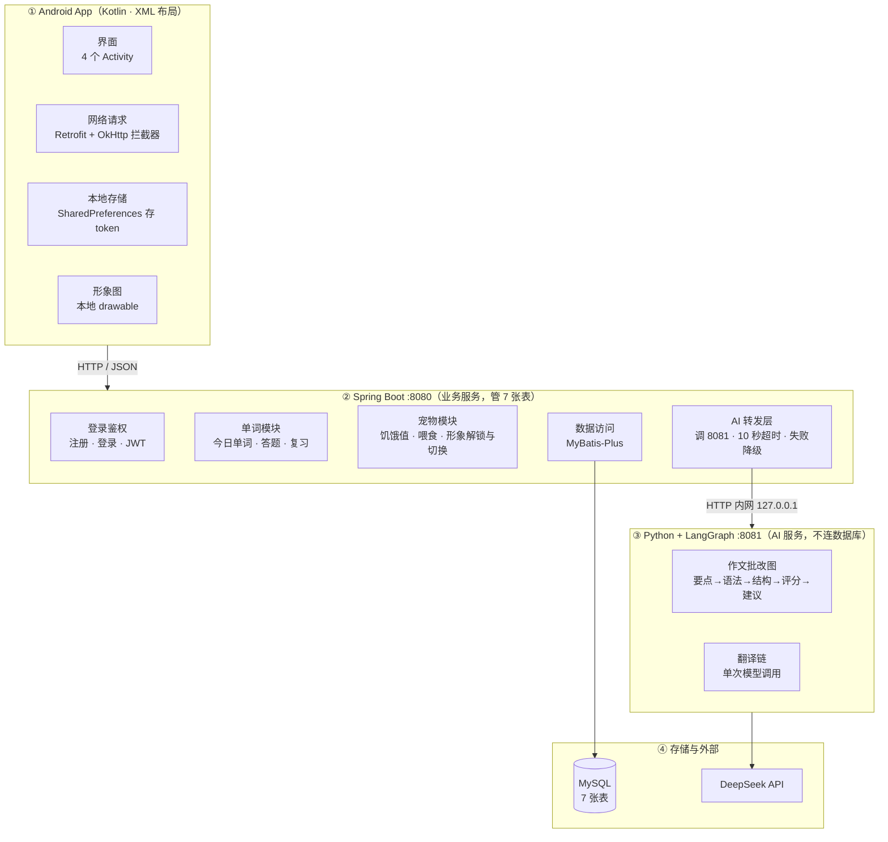
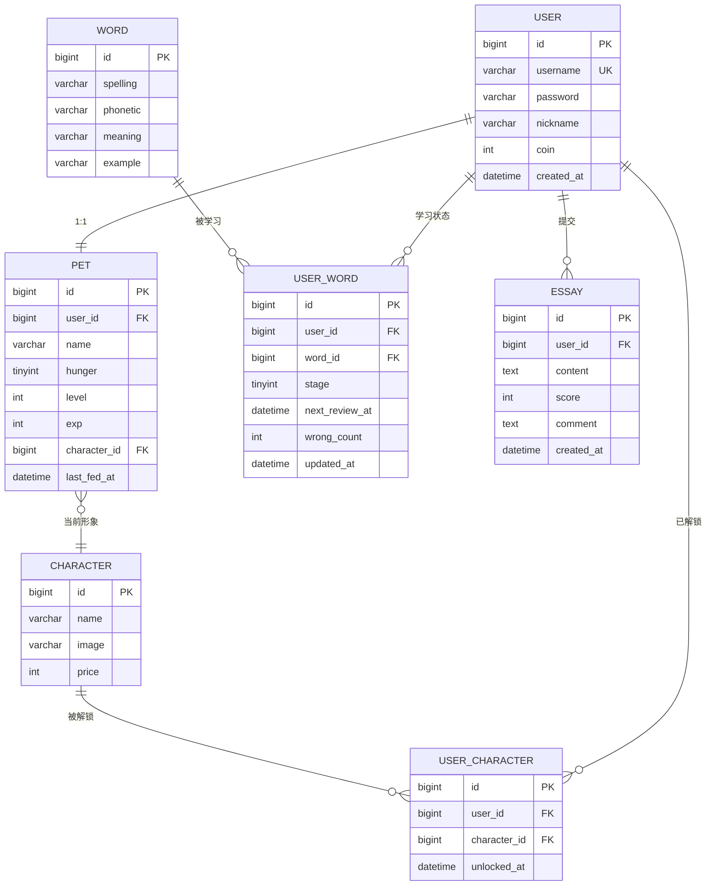

# 英语学习 App · 结课作业实施方案

> 在完整产品方案上做了减法：**业务部分**只保留能跑通一条闭环的部分，**技术部分**保留两个 AI 能力（LangGraph 图 + LangChain 链）作为亮点。
> 判断标准只有一条：**答辩那天能不能完整演示一遍，代码能不能编译通过**。凡是增加工作量但演示价值不高的，一律砍掉。

| 架构 | 数据 | 接口 | 工作量 |
|---|---|---|---|
| 双服务：Spring 8080 + Python 8081 | 7 张表 | 13 个对外 + 2 个内部 | 约 10.5 人日 |

---

## 目录

1. [目标：只跑一条闭环](#一目标只跑一条闭环)
2. [技术架构](#二技术架构)
3. [做与不做](#三做与不做)
4. [数据库设计](#四数据库设计)
5. [接口清单](#五接口清单13-个)
6. [开发计划](#六开发计划7-步约-105-人日)
7. [答辩演示](#七答辩演示)

---

## 一、目标：只跑一条闭环

整个作业只需要这一条链路能走通，其余都是锦上添花。

```
注册 / 登录 → 背单词 → 答对得金币、饥饿值回升 → 解锁新形象 / 喂食 → 宠物状态变化
```

### 验收标准（三条，做到就算完成）

| # | 验收点 | 怎么算通过 |
|---|---|---|
| 1 | 能注册、能登录、重启 App 仍是登录态 | 换一台手机装同样的包，用同一账号能登进去，数据一致 |
| 2 | 能背完 10 个单词，数据写进数据库 | 答题后刷新页面进度不回退，数据库里能查到记录 |
| 3 | 金币、饥饿值、宠物形象能随学习/操作真实变化 | 答对加金币，喂食饥饿值满，金币够了能解锁并切换形象；关掉重开数值和形象都还在 |

> **本项目的技术亮点**：用 **LangGraph** 做作文批改的多步图、用 **LangChain** 做单词翻译链。
> 这两块是整个作业里唯一"值得讲"的技术内容，但工作量可控——AI 服务不碰数据库，只做纯文本进出。
> 语音对话、口型动画仍然不做。

---

## 二、技术架构

拆成两个服务，各管一段。没有网关、没有注册中心、没有 Redis、没有消息队列——两个进程都跑在本机，之间就是一次 HTTP 调用。

**为什么必须拆**：LangGraph 官方只有 Python 和 JS 实现，Java 侧（Spring AI、LangChain4j）都有 Chain 和 Agent，但**没有 StateGraph**——也就是没有"节点 + 条件边 + checkpoint 中断恢复"这套能力。所以想真跑 LangGraph，就必须有一个 Python 进程。

**为什么不拆得更细**：业务是单用户 CRUD，AI 是纯文本进出，拆成两个已经到边界了。再往下拆只会增加部署和调试成本，答辩时也更难讲清楚。



### 每个服务只干一件事

| 角色 | 干什么 | 刻意不做什么 |
|---|---|---|
| **App** | 画界面、发请求、存 token、显示宠物状态 | 不写业务规则。金币多少、饥饿值多少全由后端算好返回，客户端只显示 |
| **Spring Boot** | 账号、单词、学习进度、金币、宠物、形象——所有业务逻辑和 7 张表 | 不直接调大模型，不写提示词，不做 AI 相关的重试逻辑 |
| **Python AI 服务** | 只做两个能力：作文批改图、单词翻译链 | **不连数据库**。不查用户、不写记录，进来一段文本、出去一段 JSON |
| **存储** | 一个 MySQL + 一个模型 API | 不用 Redis、不用 OSS（形象图打成 drawable 塞进 App），不用对象存储存作文 |

> ⚠️ **两条不能省的**：
> 1. 大模型 API Key 只放 Python 服务的 `.env` 里。写在 Android 里，答辩时 apktool 一解包就能看到。
> 2. AI 服务不碰数据库。一旦它也连库，两边就会各有一套 ORM 和事务边界，出问题时你根本不知道该看哪边日志。

---

## 三、做与不做

左边是完整产品版的规划，中间是结课版实际要做的，右边是砍掉的理由。答辩被问「为什么不做 XX」，直接用这一列回答。

| 模块 | 完整版 | 结课版 | 砍掉的理由 |
|---|---|---|---|
| **登录** | 账号 / 邮箱验证码 / 手机验证码，三选一 + 绑定 | ✅ 账号 + 密码，注册 + 登录 | 验证码要接短信服务商和邮件服务器，要花钱、要备案，演示时还可能收不到 |
| **英语学习** | 五个功能全套 | ✅ 背单词（含简单复习） | 这是主线，必须有 |
| | 单词翻译、作文翻译 | ✅ 单词翻译 —— **LangChain Chain** | 一次模型调用就能完成，不需要上图，用 Chain 即可 |
| | 作文写作 + 作文打分 | ✅ 作文批改 —— **LangGraph 四步图** | 不做写作编辑器（等于做个富文本）；只做批改。多步流程正好体现图编排的价值 |
| **卡通人物** | 6 个部位换装（头饰/整套/上衣/下衣/鞋/头发） | ✅ **多套完整形象任选**，部分金币解锁 | 不做分层换装——分层要求每个部位单独切图、尺寸和锚点严格一致，少一张就拼歪。改成「整套形象切换」：一个形象一张完整图，同样能演示「金币解锁 + 个性化」，素材成本却低一个数量级 |
| | 饥饿值 + 学习状态 + 待商议属性 | ✅ 饥饿值 + 等级 | 属性越多数值越难调。饥饿值一个就够撑起养成感 |
| **数据库** | 28 张表，5 个域 | ✅ 7 张表 | 形象用 character / user_character 两张表就够，不需要 item、库存、部位、穿戴关系那一套；作业也不需要订单、支付、成就、埋点 |
| **页面** | 主界面 / 商城 / 报告 / 我的 / 对话 … | ✅ 4 个页面 | 登录页、首页（宠物）、背单词页、我的页。形象选择做成首页的 BottomSheet 弹层，不单独开页面 |
| **口语对话** | ASR + TTS + 发音评测 + 口型动画 | ❌ 不做 | 要录音权限、音频上传、第三方评测、序列帧动画。任一环出问题演示就崩，投入产出比最低 |
| **运营功能** | 成就 / 排行榜 / 每日任务 / 推送 / 埋点 / 多端 / 家长端 | ❌ 不做 | 没有用户量的情况下做了也看不出效果，纯属增加答辩时要讲的复杂度 |

**砍完还剩什么？** 一条完整的「登录 → 学习 → 奖励 → 养成」链路 + 两个 AI 能力（其中一个是 LangGraph 图）+ 4 个页面 + 7 张表 + 2 个服务。代码量约 3500–4500 行（Android 1900 左右，Spring 1200 左右，Python 400 左右）。

> ⚠️ **形象素材的前置条件**：每个形象需要一张**完整的** PNG（建议 256×256、透明底、同一朝向同一构图），App 里按 drawable 资源名索引。`picture/` 下现有的那批**不能用**——都是精灵图集被裁切后的残片，最外圈全部触边截断，没有一帧是完整的，放大就是一堆断肢。要么自己画/生成一套，要么先用 4 个色块占位图把逻辑跑通再换图。

---

## 四、数据库设计

从 28 张压到 7 张。合并原则：能用一个字段表达的就不开表，能用一次查询算出来的就不存冗余。`user_word` 一张表同时承担「学习进度 + 复习计划 + 错题」三件事。



### 字段说明

| 表 | 字段 | 说明 |
|---|---|---|
| `user` | `id` `username` `password` `nickname` `coin` `created_at` | `username` 唯一索引；`password` 存 BCrypt 哈希，别存明文 |
| `word` | `id` `spelling` `phonetic` `meaning` `example` | 初始化脚本导入 200 个四六级词，够演示用 |
| `user_word` | `id` `user_id` `word_id` `stage` `next_review_at` `wrong_count` `updated_at` | 唯一索引 `(user_id, word_id)`；`stage` 是复习阶段 0–4 |
| `pet` | `id` `user_id` `name` `hunger` `level` `exp` `character_id` `last_fed_at` | `user_id` 唯一；注册时自动创建一只宠物，`character_id` 指向当前正在用的形象 |
| `character` | `id` `name` `image` `price` | 形象字典，初始化导入 4–6 个；`price = 0` 是注册即送的默认形象，其余按 50 / 100 / 200 分档；`image` 存 drawable 资源名，不存 URL |
| `user_character` | `id` `user_id` `character_id` `unlocked_at` | 唯一索引 `(user_id, character_id)`，防止重复解锁扣两次钱；注册时插一条默认形象 |
| `essay` | `id` `user_id` `content` `score` `comment` `created_at` | 批改结果直接存本表，不另开 review 表 |

### 建表 SQL

```sql
-- 用户
CREATE TABLE `user` (
  `id`         BIGINT       NOT NULL AUTO_INCREMENT,
  `username`   VARCHAR(32)  NOT NULL,
  `password`   VARCHAR(100) NOT NULL COMMENT 'BCrypt 哈希',
  `nickname`   VARCHAR(32)  DEFAULT NULL,
  `coin`       INT          NOT NULL DEFAULT 0,
  `created_at` DATETIME     NOT NULL DEFAULT CURRENT_TIMESTAMP,
  PRIMARY KEY (`id`),
  UNIQUE KEY `uk_username` (`username`)
) ENGINE=InnoDB DEFAULT CHARSET=utf8mb4;

-- 单词（初始化导入，运行期只读）
CREATE TABLE `word` (
  `id`       BIGINT       NOT NULL AUTO_INCREMENT,
  `spelling` VARCHAR(64)  NOT NULL,
  `phonetic` VARCHAR(64)  DEFAULT NULL,
  `meaning`  VARCHAR(255) NOT NULL,
  `example`  VARCHAR(500) DEFAULT NULL,
  PRIMARY KEY (`id`),
  KEY `idx_spelling` (`spelling`)
) ENGINE=InnoDB DEFAULT CHARSET=utf8mb4;

-- 用户学习状态（进度 + 复习 + 错题 三合一）
CREATE TABLE `user_word` (
  `id`             BIGINT   NOT NULL AUTO_INCREMENT,
  `user_id`        BIGINT   NOT NULL,
  `word_id`        BIGINT   NOT NULL,
  `stage`          TINYINT  NOT NULL DEFAULT 0 COMMENT '复习阶段 0-4',
  `next_review_at` DATETIME DEFAULT NULL,
  `wrong_count`    INT      NOT NULL DEFAULT 0,
  `updated_at`     DATETIME NOT NULL DEFAULT CURRENT_TIMESTAMP ON UPDATE CURRENT_TIMESTAMP,
  PRIMARY KEY (`id`),
  UNIQUE KEY `uk_user_word` (`user_id`, `word_id`),
  KEY `idx_review` (`user_id`, `next_review_at`)
) ENGINE=InnoDB DEFAULT CHARSET=utf8mb4;

-- 宠物
CREATE TABLE `pet` (
  `id`           BIGINT      NOT NULL AUTO_INCREMENT,
  `user_id`      BIGINT      NOT NULL,
  `name`         VARCHAR(32) NOT NULL DEFAULT 'Luna',
  `hunger`       TINYINT     NOT NULL DEFAULT 100,
  `level`        INT         NOT NULL DEFAULT 1,
  `exp`          INT         NOT NULL DEFAULT 0,
  `character_id` BIGINT      NOT NULL DEFAULT 1 COMMENT '当前使用的形象',
  `last_fed_at`  DATETIME    NOT NULL DEFAULT CURRENT_TIMESTAMP,
  PRIMARY KEY (`id`),
  UNIQUE KEY `uk_user` (`user_id`)
) ENGINE=InnoDB DEFAULT CHARSET=utf8mb4;

-- 形象字典（初始化导入，运行期只读）
CREATE TABLE `character` (
  `id`    BIGINT       NOT NULL AUTO_INCREMENT,
  `name`  VARCHAR(32)  NOT NULL,
  `image` VARCHAR(100) NOT NULL COMMENT 'drawable 资源名',
  `price` INT          NOT NULL DEFAULT 0 COMMENT '0 = 注册即送',
  PRIMARY KEY (`id`)
) ENGINE=InnoDB DEFAULT CHARSET=utf8mb4;

-- 用户已解锁的形象
CREATE TABLE `user_character` (
  `id`           BIGINT   NOT NULL AUTO_INCREMENT,
  `user_id`      BIGINT   NOT NULL,
  `character_id` BIGINT   NOT NULL,
  `unlocked_at`  DATETIME NOT NULL DEFAULT CURRENT_TIMESTAMP,
  PRIMARY KEY (`id`),
  UNIQUE KEY `uk_user_character` (`user_id`, `character_id`)
) ENGINE=InnoDB DEFAULT CHARSET=utf8mb4;

-- 作文批改
CREATE TABLE `essay` (
  `id`         BIGINT   NOT NULL AUTO_INCREMENT,
  `user_id`    BIGINT   NOT NULL,
  `content`    TEXT     NOT NULL,
  `score`      INT      DEFAULT NULL,
  `comment`    TEXT     DEFAULT NULL,
  `created_at` DATETIME NOT NULL DEFAULT CURRENT_TIMESTAMP,
  PRIMARY KEY (`id`),
  KEY `idx_user` (`user_id`)
) ENGINE=InnoDB DEFAULT CHARSET=utf8mb4;
```

### 两条简化规则，写代码前先定死

**饥饿值怎么算** —— 不写定时任务，每次读宠物时现算：

```java
// 等价于每小时掉 3 点，但按分钟算能让"答对 +2 点"精确对齐，不产生取整误差
int hunger = (int) Math.max(0, 100 - minutesSince(lastFedAt) / 20);
```

答对一个单词 `hunger + 2`（上限 100），喂食直接置 100。这样不用写定时任务，重启也不丢状态。

**复习间隔怎么定** —— 五个阶段固定天数，答对进一阶、答错退回 0 阶：

```
0 → 1 天 → 3 天 → 7 天 → 15 天
```

「今日单词」= 新词 10 个 + `next_review_at <= 现在` 的复习词，一条 SQL 就能查出来：

```sql
SELECT w.* FROM word w
JOIN user_word uw ON uw.word_id = w.id
WHERE uw.user_id = ? AND uw.next_review_at <= NOW()
LIMIT 10;
```

---

## 五、接口清单（13 个）

全部返回 JSON，统一用 `{code, msg, data}` 包一层。

```json
{ "code": 0, "msg": "ok", "data": { } }
```

| 方法 | 路径 | 作用 | 要点 |
|---|---|---|---|
| POST | `/api/auth/register` | 注册 | 校验用户名重复；同时创建 user + pet + 默认形象解锁记录 三条（事务） |
| POST | `/api/auth/login` | 登录 | 返回 token，App 存 SharedPreferences |
| GET | `/api/user/me` | 个人信息 | 首页顶部展示昵称、金币 |
| GET | `/api/words/today` | 今日单词 | 新词 + 到期复习词，一次返回 10 条 |
| POST | `/api/words/answer` | 提交答题 | 参数 `wordId` + 是否正确；返回加了多少金币、饥饿值、宠物状态 |
| GET | `/api/pet` | 宠物状态 | 饥饿值现算，顺便返回当前形象 id 和形象资源名 |
| POST | `/api/pet/feed` | 喂食 | 扣 5 金币，饥饿值置 100 |
| GET | `/api/characters` | 形象列表 | 返回全部形象 + 是否已解锁 + 是否是当前在用的 |
| POST | `/api/characters/unlock` | 金币解锁形象 | 校验金币够、没解锁过，扣钱并写 `user_character`（事务，`WHERE coin >= price` 防超扣） |
| POST | `/api/pet/character` | 切换形象 | 校验已解锁，只改 `pet.character_id` |
| POST | `/api/ai/translate` | 单词 / 句子翻译 | 转发给 Python 的 LangChain 链，返回释义 + 音标 + 例句 |
| POST | `/api/ai/essay` | 作文批改 | 转发给 Python 的 LangGraph 四步图，返回分数 + 维度 + 建议，存 essay 表 |
| GET | `/api/stats` | 学习统计 | 已学词数、正确率、连续天数，我的页展示 |

> **省时间的小技巧**：除了注册和登录，其余 11 个接口都需要登录态。写一个拦截器统一验 token，业务代码里直接从请求上下文取 `userId`，不要每个接口自己解析一遍。

### 内部接口：AI 服务（8081，只给 Spring 调，不对外）

App 永远只连 8080。Spring 收到 `/api/ai/*` 后，再转发给 Python，拿到结果再统一包装返回。

| 方法 | 路径 | 作用 | 返回 |
|---|---|---|---|
| POST | `http://127.0.0.1:8081/ai/essay` | 作文批改（LangGraph 四步图） | `{score, dimensions:{grammar,structure,vocabulary}, suggestions:[]}` |
| POST | `http://127.0.0.1:8081/ai/translate` | 单词翻译（LangChain Chain） | `{meaning, phonetic, example, pos}` |

**转发层要点**（这部分代码很短，但必须写对）：

```kotlin
// 伪代码示意：Spring 侧
try {
    result = restTemplate.postForObject("http://127.0.0.1:8081/ai/essay", body, EssayResult.class)
} catch (Exception e) {
    // 超时 / AI 服务没开 / 模型报错，统一降级，不要把 500 抛给 App
    return Result.fail("AI 服务暂时不可用，请稍后再试")
}
```

超时设 10 秒，比模型响应时间略长；**AI 服务没启动时，App 应该看到友好提示，而不是白屏或闪退**——答辩现场最容易出这个事故。

---

## 六、开发计划（7 步，约 10.5 人日）

顺序很重要：每一步都能独立验证，出问题容易定位。**不要先把界面画完再连后端**——那样调不通时你分不清是前端还是后端的问题。
AI 服务单独一步，先让它在命令行里用 curl 跑通，再接进 Spring，最后才做 App 页面。

| 步骤 | 耗时 | 做什么 | 这一步结束应该看到 |
|---|---|---|---|
| 1 | 1 天 | Android 空项目 + Spring hello world + 建库建表 + 导入 200 个单词和 4 个形象 | App 点一个按钮能弹出后端返回的「hello」；数据库里能 select 出单词和形象 |
| 2 | 1.5 天 | 注册 / 登录接口 + App 登录页 + token 拦截器 + 自动登录 | 注册一个账号，杀掉 App 重新打开还是登录态 |
| 3 | 2.5 天 | 今日单词、答题接口、`user_word` 读写 + App 背单词页 | 能连续答 10 个词，答对金币增加，数据库有记录 |
| 4 | 1.5 天 | 宠物接口、饥饿值计算、喂食 + 首页宠物展示 | 首页能看到宠物，点喂食饥饿值变满，数字会随时间掉 |
| 5 | 2 天 | **Python AI 服务**：建 conda 环境、装 langgraph、写作文批改四步图 + 翻译链、FastAPI 起在 8081 | 用 curl 直接打 `127.0.0.1:8081/ai/translate` 能拿到 JSON；日志里能看到图的每个节点依次执行 |
| 6 | 1 天 | Spring 转发层（超时 + 降级）+ App 翻译页、作文批改页 | App 里输入单词能出译文；输入作文能出分数和三条建议；关掉 Python 服务时不闪退，只提示「AI 不可用」 |
| 7 | 1 天 | 形象列表 / 金币解锁 / 切换 + 我的页统计 + 演示数据 + 录屏 | 能用金币解锁一个形象并切换上去；断网时不崩；录好一段 3 分钟演示 |

### 五个最容易翻车的地方

1. **第 1 步就想把架构搭漂亮。** 不要。先让 App 能拿到一个字符串，再谈分层。很多作业卡在第一天就是因为环境没配通却在写分层。
2. **把所有逻辑写在 Activity 里。** 结课作业可以简单，但至少把网络请求抽成一个类。否则改一个接口要动十个地方。
3. **AI 服务没有超时和兜底。** 模型会慢、Python 服务会忘开。Spring 侧超时 10 秒 + 失败提示，别让演示卡在那儿转圈。
4. **Python 装错解释器。** 你机器上 `python` 是 3.13、`pip` 却属于 conda 的 3.14，直接 `pip install langgraph` 会装到别处。一律用 `D:/Miniconda/envs/english-ai/python.exe -m pip install ...`。
5. **答辩前才准备数据。** 提前灌 200 个单词、给演示账号攒 100 金币、留一个解锁得起的形象。另外**先启动 Python 服务再演示**，它没开的时候 AI 功能全是提示语。

---

## 七、答辩演示

三分钟，六个镜头，按这个顺序讲，老师能立刻看懂你做了什么。

| 镜头 | 操作 | 说什么 | 为什么放在这里 |
|---|---|---|---|
| 1 | 打开 App，展示登录页，输入账号登录 | 「这是英语学习 App，用账号密码登录，登录态本地保存」 | 先证明基础功能可用 |
| 2 | 首页：宠物、金币、饥饿值 | 「首页是养成的核心。金币靠学习赚，饥饿值会随时间下降」 | 一眼看到产品形态，不是普通背单词软件 |
| 3 | 进入背单词，连答 5 个词 | 「答对加金币、宠物饥饿值回升，答错的词会进入复习队列」 | 演示主流程 + 数据真的在变 |
| 4 | 回首页，喂食 + 用金币解锁一个新形象并切上去 | 「金币在这里消耗：喂食、解锁形象，形成学习到养成的闭环」 | 闭合链路，这是作业亮点 |
| 5 | 切到翻译页，输入一个单词 | 「这里走的是 LangChain 的 Chain，一次模型调用，不需要上图」 | 说明你清楚框架的适用边界 |
| 6 | 切到作文批改，贴一段作文 | 「这个是 LangGraph 的四步图：要点、语法、结构、评分，每步独立调用，失败只重跑那一步」 | 收尾展示真正的技术含量 |

### 大概率会被问到的问题

**Q：为什么拆成两个服务？不能一个 Spring 全做了吗？**
因为 LangGraph 官方只有 Python 和 JS 实现。Java 侧的 Spring AI 和 LangChain4j 有 Chain、Agent、RAG，但没有 StateGraph——没有节点、条件边和 checkpoint 那套能力。业务是 CRUD，Spring 合适；AI 是多步图，LangGraph 合适，所以按能力边界拆。

**Q：为什么作文批改用 LangGraph，翻译不用？**
翻译一次模型调用就完成了，上图只会增加复杂度和延迟。作文批改要走"要点 → 语法 → 结构 → 评分 → 建议"五个节点，单步失败可以只重跑那一步，中间结果能落 checkpoint，这时候图才有意义。能一次做完的事不该上图。

**Q：两个服务之间怎么通信？**
就一次 HTTP 调用，`127.0.0.1:8081`，请求体是 JSON。没上 RPC、没上消息队列——都是本机进程，没必要。Spring 侧设了 10 秒超时和失败降级。

**Q：为什么不做微服务 / 不用 Redis？**
两个进程已经是按能力边界拆的极限了。单用户、单机场景，注册中心、网关、缓存带来的都是部署和调试成本，收益为零。等真有并发压力再谈，依据是压测数据。

**Q：大模型怎么接的？Key 放哪？**
Python 侧用 `langchain-openai` 接 DeepSeek 的 OpenAI 兼容接口，Key 只写在 Python 服务的 `.env` 里，Spring 不碰，App 更拿不到。Docker 里 apktool 解包也只能看到 `10.0.2.2:8080`。

**Q：饥饿值为什么不用定时任务？**
用「当前时间 − 上次喂食时间」现算，避免定时任务在服务重启后丢状态，也省了一个调度框架。

**Q：复习算法是怎么设计的？**
简化版间隔重复，五个阶段 0/1/3/7/15 天，答对进一阶、答错退回起始。比固定每天复习更符合记忆规律。

**Q：为什么不做分层换装，而是整套形象切换？**
分层换装要给每个部位单独切图，而且所有图的画布尺寸、人物锚点必须像素级对齐，一套素材至少 6 张还得按体型分开，素材成本比写代码还高，拼歪一点整个形象就废了。整套形象切换是「一人一张完整图」，代码只多两张表三个接口，同样能演示金币消耗和个性化，投入产出比高得多。

**Q：形象图片存在哪？会不会影响启动速度？**
图片不打网络，直接以 drawable 塞在 App 里，数据库只存资源名，客户端用 `getIdentifier` 取。形象数量是个位数，对包体和启动速度都没有影响，也省掉了图床和 OSS。

**Q：如果要多用户并发怎么办？**
先把金币扣减改成带条件的更新（`WHERE coin >= 5`）防超扣，再考虑加缓存和队列。目前是单机事务，够用。

**Q：下一步想做什么？**
口语对话（对着宠物说英语）——这是这个产品真正有差异的地方，需要音频链路（ASR/TTS）+ 有状态的对话图，正好是 LangGraph 擅长的场景，这学期时间不够，留在后续。

---

## 附：技术栈与启动顺序

| 位置 | 选择 | 备注 |
|---|---|---|
| Android | Kotlin + Android Studio（2023.1），compileSdk 34 / minSdk 24 | XML 布局 + ViewBinding，定了不中途换 |
| 网络 | Retrofit 2 + OkHttp + Gson | 拦截器统一加 `Authorization` 头 |
| 图片 | 本地 drawable | 形象图按数据库里的资源名用 `getIdentifier` 取，不打网络，省掉 Glide 和 OSS |
| 业务后端 | Spring Boot 3.2 + Maven，JDK 17，端口 **8080** | MyBatis-Plus；BCrypt 存密码；JWT 发 token |
| AI 服务 | Python **3.12** + FastAPI + **LangGraph** + LangChain，端口 **8081** | conda 独立环境 `english-ai`，不污染已有环境 |
| 模型接入 | `langchain-openai` 接 DeepSeek（OpenAI 兼容） | 模型 `deepseek-chat`，超时 10 秒 |
| 数据库 | MySQL 8.0（本机已装，root 已验证可连） | 库名 `english_app`，utf8mb4 |

### 启动顺序（每次开发/演示都要按这个来）

```bash
# 1. 数据库（Windows 服务，通常开机自启）
mysql -u root -p -e "select 1"

# 2. Python AI 服务（先起它，否则 App 的 AI 功能全是提示语）
D:/Miniconda/envs/english-ai/python.exe -m uvicorn app.main:app --port 8081

# 3. Spring Boot
mvn spring-boot:run          # 或直接在 IDE 里跑

# 4. 模拟器
"$ANDROID_HOME/emulator/emulator.exe" -avd Pixel_3a_API_36_extension_level_17_x86_64

# 5. 装 App
cd android-app && ./gradlew installDebug
```

**只要记一句**：8081 没起，AI 功能就废；8080 没起，整个 App 就废。

### 演示数据准备清单

- [ ] 200 个单词已导入，`SELECT COUNT(*) FROM word` 能查到
- [ ] 4–6 个形象已导入 `character` 表，默认形象 `price = 0`，其余分档 50/100/200
- [ ] 演示账号已注册，金币充值到 100，够解锁一个形象
- [ ] 宠物状态正常（饥饿值不是 0，避免一打开就是惨状）
- [ ] 已答对过几个词，我的页统计不为空
- [ ] **Python 服务已启动**，`curl 127.0.0.1:8081/ai/translate` 有返回
- [ ] DeepSeek Key 有效，余额够（别在答辩当天发现欠费）
- [ ] 包已在一台干净手机上安装成功并跑通一遍
- [ ] 全程录屏已保存，防止现场网络出问题
